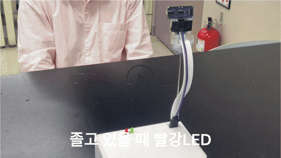

# 비대면 출석 및 시험 감독 시스템 (캡스톤디자인 2025)

경기대학교 전자공학설계(캡스톤디자인) 2025년 1학기 3인 팀 프로젝트입니다. Raspberry Pi 카메라 하나로 응시자의 출석을 확인하고 시험 중 졸음·자리 비움·손 내림·시선 이탈을 감지해 LED로 바로 알리고 MariaDB에 기록합니다.



*시연 영상 중 졸음 감지 장면. 카메라 아래 장치의 빨간 LED가 켜집니다.*

## 내 역할

하드웨어 구성과 회로를 맡았고 알고리즘 일부와 처리 경량화를 함께 했습니다. 카메라 모듈·초음파 센서·LED를 Raspberry Pi GPIO에 연결하고 주변 장치 제어 회로를 구성했습니다. 판정 항목이 늘면서 처리 지연이 약 1초까지 생겼을 때 팀원들에게 실시간성을 기준으로 다시 손보자고 제안했고 배선 정리와 판정 코드 정리로 지연을 줄였습니다.

## 시스템 구성

```
초음파 센서 ─(200cm 이내 접근)─▶ 카메라 시작
Raspberry Pi Camera (Picamera2 · 640×480)
   └ MediaPipe Face Mesh / Hands ─▶ 판정
        ├ 빨간 LED (GPIO 17) / 초록 LED (GPIO 18)
        └ MariaDB status_table 에 상태와 시각 기록 ─▶ 관리자가 Workbench로 확인
```

| 모드 | 판정 | 방법 |
|---|---|---|
| 출석 | 졸음 | 눈 종횡비(EAR)가 0.15 아래로 2초 이상 유지 |
| 출석 | 부재 의심 | 10초 동안 눈 깜빡임이 한 번도 없음. 사진을 카메라 앞에 세워 두는 경우를 겨냥한 조건 |
| 시험 감독 | 손 내림 | 화면에 손이 2개 미만으로 잡힘 |
| 시험 감독 | 시선 이탈 | 얼굴 랜드마크로 머리 방향을 보정한 시선 선이 좌우로 기준 이상 벗어남 |

판정 기준 시간은 시연용 최종 코드의 값입니다.

## 코드

| 경로 | 내용 |
|---|---|
| `src/monitoring/monitoring_final_rpi_db_gpio.py` | 시험 감독 최종본 (Raspberry Pi · GPIO · MariaDB · 2025-05-27) |
| `src/attendance/attendance_final.py` | 출석 확인 최종본 (Raspberry Pi · GPIO · MariaDB) |
| `src/monitoring/gaze_head_pose_notes.py` | 머리 방향으로 시선을 보정하는 함수와 설명 |
| `src/hardware/` | 카메라 색 보정(CLAHE) · 초음파 거리 측정 · 서보와 LED 제어 실험 코드 |
| `src/*/history/` | 노트북 버전에서 Raspberry Pi 버전으로 옮겨 간 중간 버전들 |

코드는 팀 노션에 남아 있던 것을 그대로 옮겼습니다. DB 접속 정보만 환경변수(`DB_USER` · `DB_PASSWORD` · `DB_HOST`)로 바꿨습니다. `src/hardware/ultrasonic_servo_led_socket.py`는 노션에 남은 조각 그대로라 들여쓰기가 깨져 있어 실행되지 않습니다.

## Raspberry Pi로 옮기며 겪은 문제

- 노트북에서 돌던 MediaPipe 코드를 Raspberry Pi의 PyCharm과 Thonny에서 실행하자 `mediapipe` 모듈을 못 찾거나 `SIGABRT`로 종료됐습니다. mediapipe가 가상환경(`myenv`) 안에만 설치돼 있던 게 원인으로 보였습니다. 터미널에서 가상환경으로 실행하자 `cpuinfo` 오류와 TensorFlow Lite 경고가 남았는데 동작에 영향이 없는 메시지라는 걸 하나씩 확인했습니다.
- 카메라를 OpenCV `VideoCapture`에서 `Picamera2`로 바꿨습니다. Picamera2는 RGB 순서로 프레임을 넘겨서 OpenCV용 BGR 변환을 넣었습니다.
- 판정 결과를 화면에만 띄우던 것을 MariaDB에 쌓도록 바꿔서 관리자 PC에서 실시간으로 볼 수 있게 했습니다.

## 실행 환경

Raspberry Pi · Raspberry Pi OS · Python 3 · `opencv-python` · `mediapipe` · `picamera2` · `mariadb` · `gpiozero` · `pigpio`

```bash
export DB_USER=... DB_PASSWORD=... DB_HOST=...
python src/monitoring/monitoring_final_rpi_db_gpio.py
```
